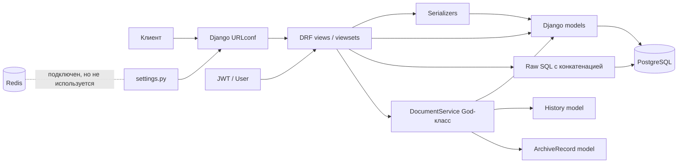

# Архитектура учебного монолитного приложения

## 1. Назначение и границы системы

Приложение моделирует внутренний документооборот компании. Сотрудник создает договор, служебную записку или счет, после чего документ проходит согласование в зависимости от суммы:

| Сумма | Обязательные согласующие |
|---:|---|
| Менее 1 000 ₽ | Руководитель отдела |
| От 1 000 до 10 000 ₽ включительно | Руководитель отдела, юрист |
| Более 10 000 ₽ | Руководитель отдела, юрист, финансовый директор |

Согласующий может одобрить документ или отклонить его с комментарием. После прохождения всех этапов документ регистрируется в архиве. Для каждого действия хранится история.

Это **намеренно неидеальный монолит**. Все части запускаются одним Django-процессом и работают с одной базой PostgreSQL, однако границы ответственности намеренно размыты, чтобы их можно было выделять и исправлять в учебном проекте.

## 2. Общая схема архитектуры

### Логическая схема

```text
Клиент (web/mobile/API client)
             |
             v
      Django URLconf
             |
             v
   DRF Views / ViewSets
   - принимают HTTP-запрос
   - проверяют часть полей
   - проверяют роли через строки
   - содержат бизнес-логику
   - местами выполняют raw SQL
             |
        +----+----------------------+
        |                           |
        v                           v
  DocumentService                Django ORM
  (God-класс)                 + raw SQL из views
  - создание                 - User
  - согласование             - Document
  - отклонение               - Approval
  - архивирование            - History
  - запись истории                 |
        |                           v
        +----------------------> PostgreSQL

Redis подключен в конфигурации, но ни один прикладной сценарий его не использует.
```

### Как нарушена слоистость

В корректной схеме представление должно преобразовывать HTTP в команду, application/service layer должен управлять сценарием, а repository/data layer должен скрывать хранение. Здесь границы нарушены:

- `views.py` напрямую читает и изменяет модели Django;
- отдельные views формируют SQL конкатенацией строк;
- часть бизнес-правил находится в `DocumentService`, часть в views, часть в `models.py`;
- сериализаторы делают поверхностную проверку входа и не являются единственным входом в доменные правила;
- история записывается из разных мест разными способами;
- транзакционная граница не совпадает с бизнес-операцией.

В результате HTTP-слой знает о таблицах и SQL, а сервис знает о конкретных Django-моделях и способе аутентификации.

## 3. Предлагаемая структура учебного проекта

Ниже показана структура, которую студент видит в коде. Доменные зоны присутствуют концептуально, но физически намеренно перемешаны в одном приложении.

```text
document-workflow-monolith/
├── manage.py                         # Точка запуска команд Django
├── requirements.txt                  # Зависимости Django, DRF, JWT, PostgreSQL, Redis
├── .env.example                      # Намек на настройки, фактически не используется
├── README.md                         # Краткое описание и инструкции запуска
├── config/
│   ├── __init__.py                   # Пакет конфигурации
│   ├── settings.py                   # Django-настройки; секреты захардкожены
│   ├── urls.py                       # Корневые маршруты API
│   └── wsgi.py                       # WSGI-точка входа
├── apps/
│   └── documents/
│       ├── __init__.py               # Единое Django-приложение для всех доменов
│       ├── admin.py                   # Регистрация всех моделей в админке
│       ├── apps.py                    # Конфигурация приложения
│       ├── models.py                  # User, Document, Approval, History и ArchiveRecord
│       ├── views.py                   # API, SQL, проверки ролей и бизнес-операции вперемешку
│       ├── serializers.py             # HTTP-сериализация и неполная валидация
│       ├── services.py                # DocumentService, God-класс сценариев + raw SQL с конкатенацией
│       ├── utils.py                   # MD5 без соли, float для денег, копия ролей, print-«логгер»
│       ├── migrations/
│       │   └── 0001_initial.py        # Одна большая миграция всех таблиц
│       └── tests.py                   # Интеграционные тесты + тесты, фиксирующие уязвимости
├── fixtures/demo.json                # Демо-пользователи (пароль `pass`, MD5) и документ
├── docs/architecture.md              # Этот документ
├── schema.yml                        # Экспорт OpenAPI
└── Dockerfile, docker-compose.yml    # web + postgres:15 + redis:7
```

Существенная особенность дизайна: отдельные домены не получают собственных Django apps или пакетов.

## 4. Пять bounded contexts

### 4.1. User Management

Сотрудники, учетные записи, отделы и роли (`employee`, `manager`, `lawyer`, `cfo`, `admin`). Здесь находятся регистрация, вход и получение текущего пользователя.

Намеренное смешение: пользовательская модель лежит рядом с документами, пароль может обрабатываться собственной MD5-функцией, а право действия проверяется строковым сравнением в view.

### 4.2. Document Lifecycle

Тип документа, автор, сумма, контрагент, содержимое, дата создания и редактирования. Логика создания, изменения, отправки на согласование и удаления черновика.

Намеренное смешение: модель документа изменяет статус напрямую, а view одновременно принимает запрос, вычисляет маршрут и сохраняет модель.

### 4.3. Approval Workflow

Этапы согласования, назначенные согласующие, решения, комментарии и правила выбора маршрута по сумме. Это контекст, отвечающий за переходы `pending_manager`, `pending_lawyer` и `pending_cfo`.

Намеренное смешение: порядок этапов реализован условиями вроде `if amount < 1000`, а переход может быть вызван как view, так и God-классом без единого автомата состояний.

### 4.4. Audit & History

Полная история действий: создание, изменение, отправка, одобрение, отклонение, архивирование, пользователь, время, комментарий и прежний/новый статус.

Намеренное смешение: `History` является обычной моделью, но запись делается в нескольких местах; часть операций не охватывает одну транзакцию с основной записью.

### 4.5. Archive

Регистрация окончательно согласованного документа, архивный номер, дата регистрации и поиск архивных документов.

Намеренное смешение: архивирование не отделено от процесса согласования, может вызываться отдельным endpoint без надежной проверки финального статуса, а архивная запись и смена статуса могут рассинхронизироваться.

## 5. Жизненный цикл документа

```text
                         +------------------+
                         |                  v
                      rejected <-------- pending_manager
                         ^                  |
                         |                  v
                         +------------ pending_lawyer
                         ^                  |
                         |                  v
                         +-------------- pending_cfo
                                            |
                                            v
                                         approved
                                            |
                                            v
                                         archived

 draft --submit--> pending_manager
```

Фактический маршрут после `pending_manager` зависит от суммы:

- меньше 1 000 ₽: `pending_manager -> approved`;
- от 1 000 до 10 000 ₽ включительно: `pending_manager -> pending_lawyer -> approved`;
- больше 10 000 ₽: `pending_manager -> pending_lawyer -> pending_cfo -> approved`.

Из любого этапа согласования разрешен переход в `rejected`, но только с непустым комментарием. В намеренно плохой версии нет надежного FSM и централизованной таблицы переходов: любой endpoint может присвоить произвольную строку статуса. Повторное согласование, архивирование черновика и одобрение не того этапа поэтому не исключены.

## 6. Диаграмма компонентов



Ключевые зависимости направлены не через устойчивые порты, а непосредственно к Django ORM, конкретной модели и глобальным настройкам. Поэтому изменение способа хранения или перенос workflow в отдельный модуль затрагивает views, serializers, services и тесты одновременно.

## 7. Архитектурные проблемы и направление исправления

| № | Проблема / антипаттерн | Почему это плохо | Исправление |
|---:|---|---|---|
| 1 | **Божественный объект / God Class**: `DocumentService` делает все операции | Высокая связность, длинные методы, трудно понять и протестировать одну операцию | Разделить use cases: создание документа, согласование, отклонение, архивирование, аудит |
| 2 | **Смешение ответственности** во views | HTTP, правила бизнеса, SQL и авторизация меняются вместе | Оставить во view только transport-код, перенести сценарии в application services |
| 3 | **Лапша-код / Spaghetti Code** | Поток выполнения размазан по условиям и хелперам, новые правила порождают еще ветвления | Ввести явные команды, policy/rule objects и таблицу переходов |
| 4 | SQL-инъекция в raw SQL | Пользовательский ввод может изменить запрос и раскрыть или изменить данные | Использовать ORM/параметризованные запросы, запретить конкатенацию SQL, добавить security-тесты |
| 5 | MD5 без соли для паролей | Пароли быстро перебираются, возможны rainbow tables; это не password hashing | Использовать Django `set_password`, Argon2 или PBKDF2 и мигрировать существующие пароли |
| 6 | Секреты в `settings.py` | Ключи и пароли попадают в git и логи, компрометируя среду | Переменные окружения, secret manager, разные настройки по окружениям |
| 7 | Роли проверяются hardcode-условиями | Правила доступа дублируются, легко забыть проверку на новом endpoint | Django permissions, DRF permission classes, object-level authorization |
| 8 | Поверхностная валидация входа | Некорректная сумма, статус или комментарий доходят до БД и workflow | Serializer validation плюс доменные инварианты на границе use case |
| 9 | Нет общей транзакции для документа и истории | Документ может сохраниться без аудита или наоборот; аудит перестает быть достоверным | `transaction.atomic`, ограничения БД, outbox для внешних событий |
| 10 | Нет конечного автомата статусов | Возможны незаконные переходы, повторное одобрение и архивирование черновика | FSM/state pattern, явные команды и проверка переходов |
| 11 | Нет абстракций и dependency inversion | Код привязан к Django ORM, PostgreSQL и JWT, изоляция тестами почти невозможна | Ввести порты, репозитории и адаптеры только там, где это оправдано |
| 12 | Redis подключен, но не используется | Лишняя инфраструктурная зависимость без эффекта, нет понимания cache policy | После измерений кешировать справочники и read-heavy запросы, задать TTL и инвалидацию |
| 13 | `print()` и безконтекстный `logging.info()` | Нельзя связать событие с документом, пользователем и запросом; шум мешает расследованию | Структурированные записи с `request_id`, `document_id`, `actor_id`, уровнем и событием |
| 14 | Одна большая миграция | Сложно откатывать изменения и понять историю схемы, риск долгих блокировок | Небольшие тематические миграции, review и проверка на копии production-схемы |
| 15 | Все bounded contexts в одном Django app | Команды и изменения пересекаются, зависимости становятся неявными | Сначала физические пакеты внутри монолита, затем отдельные Django apps при необходимости |
| 16 | Слабое разграничение видимости документов | Пользователь может получить чужой документ, если фильтр строится только по `id` | Object-level permission и querysets, фильтрующие доступ по владельцу/роли |
| 17 | Магические числа и строки статусов | Ошибка в границе суммы или опечатка в статусе меняет маршрут | Константы/value objects, decimal для денег и тесты граничных значений |
| 18 | Синхронное выполнение всего сценария в HTTP | Медленная регистрация или уведомления задерживают запрос и усложняют откат | После стабилизации домена вынести уведомления и тяжелые действия в очередь |

## 8. Предложения по улучшению

### Переход к модульному монолиту

1. Разделить код на внутренние модули `users`, `documents`, `workflow`, `audit`, `archive`, сохранив один deploy и одну PostgreSQL-базу.
2. Описать публичные входы модулей: команды/use cases и read-запросы. Не импортировать внутренние модели из соседних модулей без необходимости.
3. Ввести `DocumentApprovalPolicy` или таблицу правил маршрута, а переходы оформить как команды `SubmitDocument`, `ApproveDocument`, `RejectDocument`, `ArchiveDocument`.
4. Перенести работу с БД в repositories/query services, а интеграции с JWT, Redis и логированием оставить адаптерами.
5. Сделать операции изменения документа и записи аудита атомарными.
6. Заменить MD5, секреты и самодельные permission-проверки до дальнейшего распараллеливания работ.
7. Добавить contract tests для публичных границ модулей и не допускать циклических импортов.

### Возможное выделение микросервисов позже

Не следует начинать с микросервисов. После стабилизации модульного монолита кандидатами могут стать:

- `Approval Workflow Service`, если процесс согласования имеет отдельную нагрузку и часто меняется;
- `Archive Service`, если архив должен иметь отдельное хранилище, сроки хранения и аудит доступа;
- `Audit Service`, если история становится централизованным неизменяемым журналом для нескольких систем.

`User Management` разумнее сначала заменить на корпоративный IdP/SSO, а не строить самостоятельный сервис пользователей. Межсервисные события можно публиковать через outbox и брокер сообщений; синхронные REST-вызовы оставить только для запросов, где нужна немедленная проверка.

## 9. Тестирование

Из-за текущей структуры особенно трудно написать:

- **Изолированные unit-тесты workflow**: God-класс напрямую обращается к ORM, JWT и конкретному логгеру.
- **Тесты границ сумм**: правила разбросаны по views, поэтому легко пропустить ровно `1 000`, `10 000` и `10 000.01`.
- **Тесты авторизации**: hardcode ролей не гарантирует object-level доступ к чужому документу.
- **Тесты атомарности**: рассинхрон документа и истории проявляется только при ошибке в середине сценария.
- **Тесты SQL-безопасности**: нужны интеграционные проверки с реальной PostgreSQL и вредоносными входными значениями.
- **Тесты переходов**: отсутствие FSM позволяет создать много невалидных комбинаций статуса и роли.

Минимальный набор после рефакторинга:

- unit-тесты маршрутизации по сумме и допустимых переходов;
- unit-тесты permission policy;
- integration-тесты репозиториев и транзакций на PostgreSQL;
- API-тесты успешного согласования и отклонения на каждом этапе;
- security-тесты SQL injection, IDOR и утечки секретов;
- contract-тесты публичных интерфейсов модулей;
- property-based или параметризованные тесты границ сумм;
- проверка, что каждое изменение статуса создает ровно одну запись истории.

## 10. План рефакторинга на семестр

### Этап 1. Безопасность и наблюдаемость, недели 1–4

- вынести секреты в окружение и проверить `.gitignore`;
- перейти на Django password hashing;
- заменить raw SQL параметризованными запросами или ORM;
- добавить валидацию сумм, типов документов и комментариев;
- закрыть IDOR и централизовать базовые permission classes;
- заменить `print()` на логирование с идентификаторами запроса и документа;
- добавить регрессионные security-тесты.

**Результат:** приложение еще монолитное и смешанное, но основные очевидные уязвимости закрыты.

### Этап 2. Управление состоянием и целостность, недели 5–8

- описать состояния и переходы в одном месте;
- разделить команды создания, отправки, одобрения, отклонения и архивации;
- добавить `transaction.atomic` для изменения документа и истории;
- сделать деньги `Decimal`, вынести границы в именованные правила;
- разбить большую миграцию на понятную историю изменений.

**Результат:** workflow предсказуем, незаконные переходы и рассинхрон становятся тестируемыми.

### Этап 3. Модульный монолит, недели 9–12

- физически разделить пять bounded contexts на пакеты;
- убрать импорт моделей соседних контекстов из views;
- ввести application services, repositories/query services и DTO/команды;
- определить публичные контракты модулей и запретить циклические зависимости;
- перенести API-слой на эти контракты.

**Результат:** один deploy остается, но изменение workflow не требует знания всего приложения.

### Этап 4. Производительность и подготовка к выделению сервисов, недели 13–16

- измерить дорогие чтения и применить Redis только для подходящих данных с инвалидацией;
- добавить фоновые задачи для уведомлений и тяжелой архивной обработки;
- внедрить outbox для надежной публикации событий;
- усилить метрики, трассировку и нагрузочные тесты;
- оценить, действительно ли `workflow`, `archive` или `audit` имеют независимые границы для отдельного сервиса.

**Результат:** микросервисное выделение принимается по нагрузке и границам ответственности, а не как механическое разбиение файлов.

## 11. Итоговый учебный эффект

Начальная версия специально демонстрирует **God Object**, **Spaghetti Code**, **смешение ответственности**, **tight coupling**, **отсутствие абстракций**, **hardcoded security**, **magic numbers**, **SQL injection**, **отсутствие транзакционной целостности** и **анемичную модель с произвольным статусом**. Ее ценность в том, что каждое улучшение можно проверять тестами и наблюдать, как локальная правка постепенно превращает связанный Django-монолит в модульный монолит с явными доменными границами.
